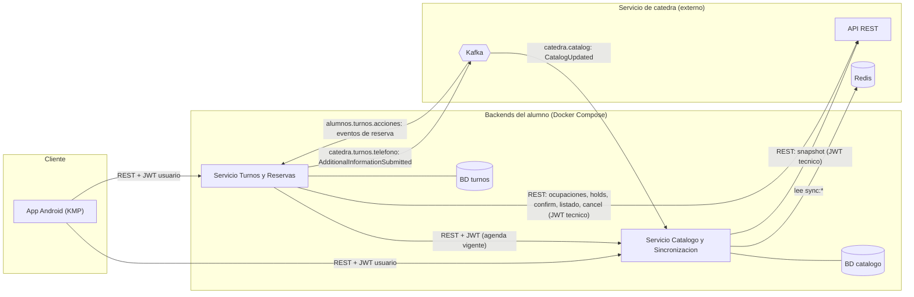
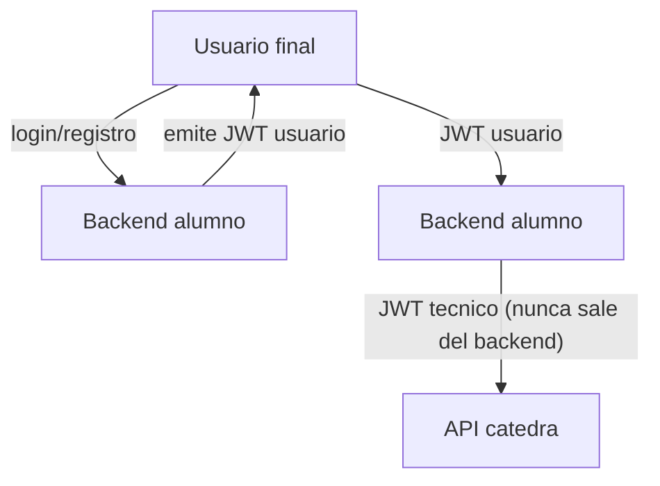

# 01 - Arquitectura general

> Borrador de diseño. Los puntos marcados como **[decidir]** son decisiones abiertas.

## Componentes y comunicaciones

## Reglas que el diagrama debe respetar

- La app KMP **nunca** habla con la catedra ni conoce el JWT tecnico.
- Cada servicio es dueño exclusivo de su BD (esquemas/usuarios separados, migraciones propias).
- Turnos **no** replica el catalogo: le pide la agenda vigente a Catalogo antes de cada operacion nueva.
- Catalogo es el unico que consume `catedra.catalog` y lee Redis `catedra:sync:*`.
- Turnos es el unico que consume `alumnos.turnos.acciones` y produce `catedra.turnos.telefono`.
- Ambos backends comparten la misma cuenta tecnica (mismo JWT de catedra), cargada por variables de entorno.

## Dos identidades, dos JWT

## Decisiones

- Catalogo emite el JWT de usuario (D2); Turnos lo valida con HS256 y secreto compartido (D32) y lo propaga al llamar a Catalogo (D3).
- Cada servicio tiene su propia instancia de PostgreSQL (D4, D20).
