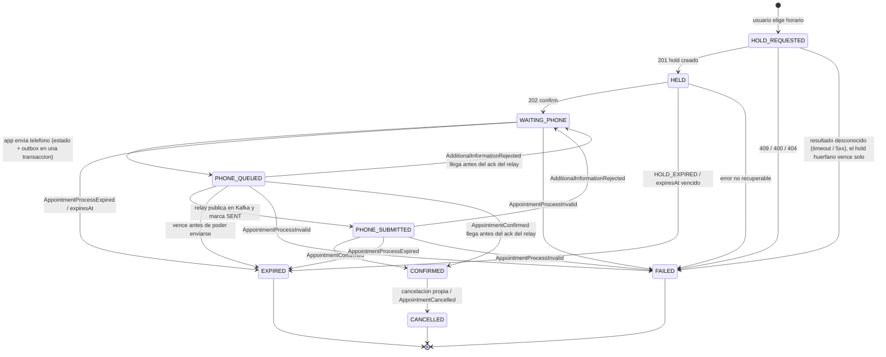
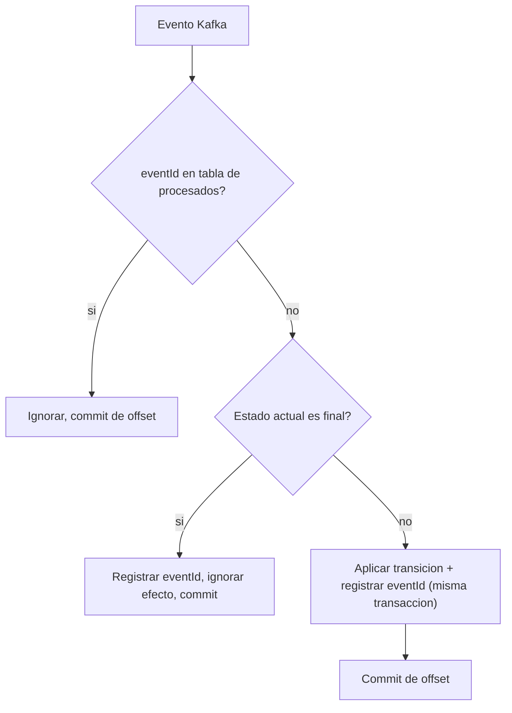

# 04 - Maquina de estados de la reserva (propuesta)

## Reglas

- **Respuesta perdida del hold (D80):** no hay idempotencia ni forma de recuperar los ids de un hold. El proceso en `HOLD_REQUESTED` pasa a `FAILED`; antes de crear otro hold se consultan las ocupaciones (si aparece `HELD`, esperar su `expiresAt` sin asumir que es nuestro; el TTL es de 10 minutos desde la creacion en el servidor). Un `409` nunca se toma como "es mi hold".
- **Estados finales:** `EXPIRED`, `FAILED`, `CANCELLED`. Un evento tardio o duplicado no los reabre.
- `CONFIRMED` solo puede pasar a `CANCELLED`.
- El relay del outbox al confirmar el ack solo marca la fila como `SENT`; el estado de la reserva pasa a `PHONE_SUBMITTED` unicamente si sigue en `PHONE_QUEUED`. Si `AppointmentConfirmed` llego antes, el estado se mantiene.
- **Resultado de pedir una transicion (TUR-09, D84):** `APPLIED` (el estado cambio), `ALREADY_IN_STATE` (ya estaba en el destino: no cambia nada, y hace idempotente repetir un pedido, por ejemplo cancelar dos veces) o `REJECTED` (el diagrama no la permite desde el estado actual: se ignora y se registra, sin excepcion; cada llamador decide que responder). Se mira primero si ya estaba en el destino y despues la tabla.
- **Bloqueo optimista:** cada proceso lleva una `version`. Si dos operaciones (REST y Kafka, o dos eventos) lo modifican a la vez, la segunda recibe un conflicto, relee el proceso y decide de nuevo sobre el estado vigente, hasta `RESERVATION_CONFLICT_MAX_ATTEMPTS` intentos (3 por defecto). Es seguro repetir porque los estados solo avanzan. Agotados los intentos, el llamador recibe el conflicto.
- **Desde `PHONE_QUEUED`** tambien se aceptan `CONFIRMED` y `WAITING_PHONE`: la respuesta de la catedra puede llegar antes de que el relay anote el ack. El relay, en cambio, solo pasa a `PHONE_SUBMITTED` desde `PHONE_QUEUED`; si el proceso ya avanzo, ese paso es `REJECTED` y no retrocede nada.
- REST y Kafka pueden contar la misma cosa en momentos distintos: se avanza solo hacia adelante y gana el estado mas avanzado. `AppointmentConfirmed` puede llegar antes de que REST lo refleje.
- Cada proceso guarda: usuario dueño, `reservationProcessId`, `holdId`, `requestEventId`, `expiresAt`, datos del slot y datos descriptivos historicos del profesional.

## Idempotencia

## Decisiones abiertas

- **[decidir]** Si el mensaje del telefono se publica directo o via tabla outbox (garantiza que no se pierda ante una caida entre guardar estado y publicar).
- **Decidido (D91):** una tarea programada pasa a `EXPIRED` los procesos abiertos con `expiresAt` vencido hace mas que un margen (60 s); antes de expirar uno en `PHONE_QUEUED` o `PHONE_SUBMITTED` consulta `GET /api/appointments` (confirmadas del paciente, sin filtro por fecha: D96) y, si la catedra lo tiene confirmado, lo repara a `CONFIRMED`; ante la duda no expira. No hay ejecucion especial al arrancar.
- **Decidido (D92):** al terminar de arrancar, una vez, los `HOLD_REQUESTED` sin ids creados antes de que arrancara la instancia pasan a `FAILED` (`HOLD_RESULT_UNKNOWN`) y los `PHONE_QUEUED` y `PHONE_SUBMITTED` que la catedra tiene confirmados (`GET /api/appointments`) se reparan a `CONFIRMED` (con la misma consulta, sin filtro por fecha: D96); ante la duda no se toca nada. `HELD`, `WAITING_PHONE` y `CONFIRMED` no se tocan.
