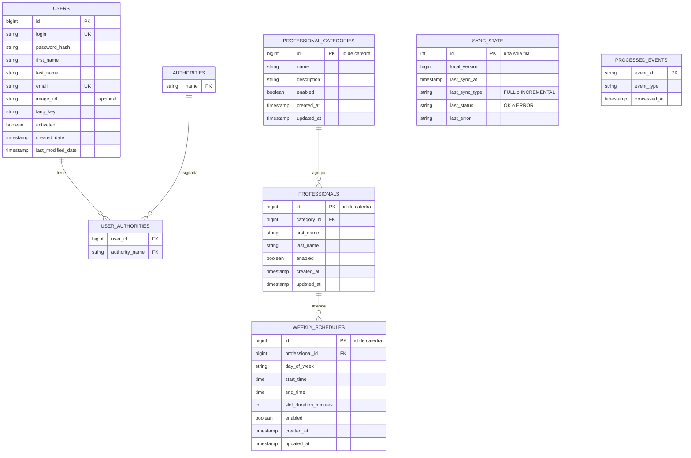
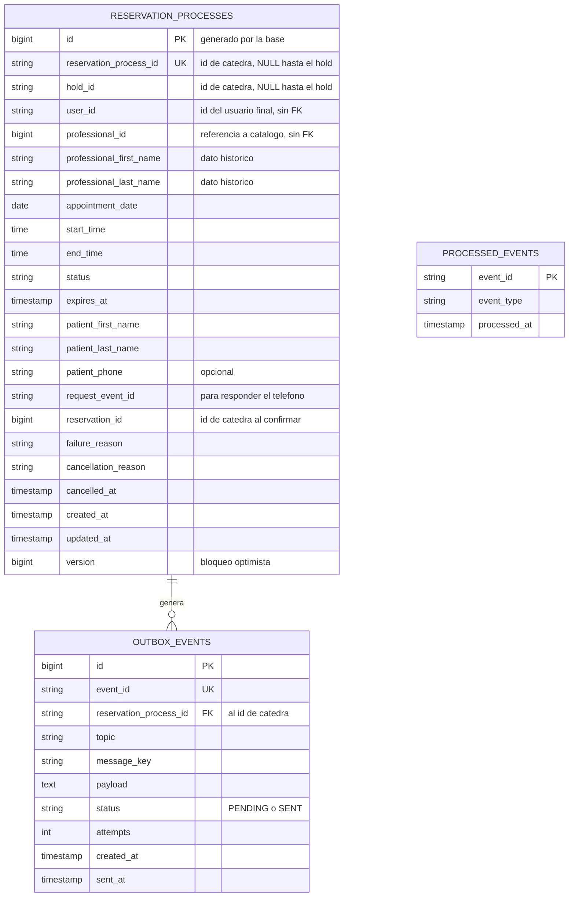
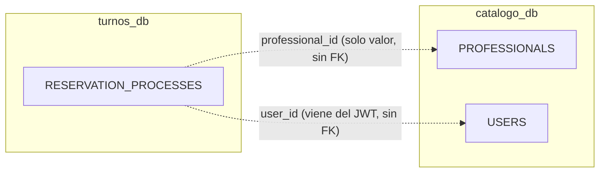

# 05 - Modelo de datos (propuesta)

Cada servicio tiene su **propia base logica** en PostgreSQL, con usuario propio y migraciones independientes. No hay claves foraneas entre ambas bases.

## Servicio Catalogo (`catalogo_db`)

Notas:

- Las entidades del catalogo conservan el **ID de la catedra** como clave primaria (no se generan IDs propios), para poder aplicar cambios por ID.
- Las bajas de la catedra son logicas (`enabled = false`): se guardan, no se borran.
- `SYNC_STATE.local_version` solo se actualiza en la misma transaccion que aplica los datos.
- `USERS` y `AUTHORITIES` replican el modelo de usuario de JHipster (requisito de compatibilidad del enunciado).
- `SYNC_STATE` cubre "informar estado y errores de sincronizacion" (4.1). La migracion crea su unica fila (`id = 1`, `local_version = 0`).
- Los nombres de las tablas van en plural (convencion de la catedra); `SYNC_STATE` queda en singular por ser una sola fila. Las tablas de turnos se nombraron igual al implementar TUR-04 (`reservation_processes`, `outbox_events`, `processed_events`).

## Servicio Turnos (`turnos_db`)

Implementado en la migracion `V1` de turnos (TUR-04, ver D78). Notas:

- `reservation_process_id` y `hold_id` aceptan `NULL`: el proceso local se crea en `HOLD_REQUESTED` antes de llamar a la catedra. El `UNIQUE` evita duplicados igual (PostgreSQL permite varios `NULL`).
- `user_id` identifica al dueño de la reserva. Viene del JWT (no del cliente) y se envia a la catedra como `externalPatientId`. Toda consulta y cancelacion filtra por este campo.
- `professional_id` y los nombres son **datos descriptivos historicos**: sirven para mostrar la reserva, no como catalogo vigente (el enunciado lo permite y lo restringe).
- `status`: `HOLD_REQUESTED`, `HELD`, `WAITING_PHONE`, `PHONE_QUEUED`, `PHONE_SUBMITTED`, `CONFIRMED`, `EXPIRED`, `FAILED`, `CANCELLED` (ver [04](04-maquina-estados-reserva.md)).
- `version` evita que dos eventos concurrentes (REST y Kafka) pisen el mismo proceso.
- `reservation_process_id` es unico: garantiza que no haya reservas duplicadas para el mismo proceso.
- `OUTBOX_EVENTS` y `PROCESSED_EVENTS` son tecnicas, no del dominio.
- `status` tiene un `CHECK` con los nueve estados: un estado nuevo exige una migracion.

## Fronteras de propiedad

Las lineas punteadas son referencias **por valor**. El servicio de turnos nunca consulta la base de catalogo: pide la agenda por REST. Esto respeta la regla de "no acceder a tablas del otro servicio".

## Decisiones

- **Identificador del usuario:** el `id` numerico de `USERS`, incluido como claim en el JWT y enviado como texto en `externalPatientId`. Es inmutable, a diferencia de cualquier dato editable, y la catedra asocia las reservas a ese valor.
- **Telefono:** se conserva en `RESERVATION_PROCESSES.patient_phone` (la catedra tambien lo devuelve en el listado).
- **Indices:** por `user_id`, por `status` + `expires_at` (job de recuperacion), por la clave foranea del outbox y uno **parcial** sobre `created_at` solo para las filas `PENDING` de `OUTBOX_EVENTS` (es lo unico que lee el relay).
